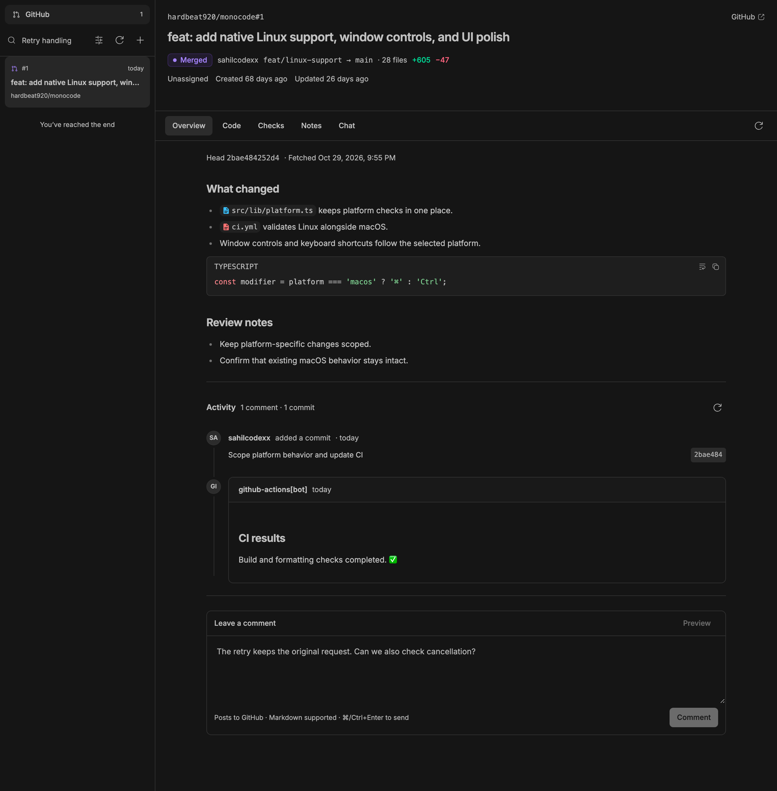
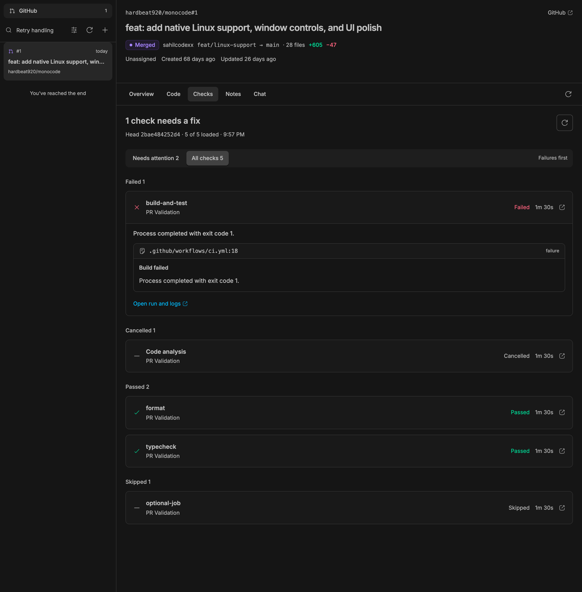
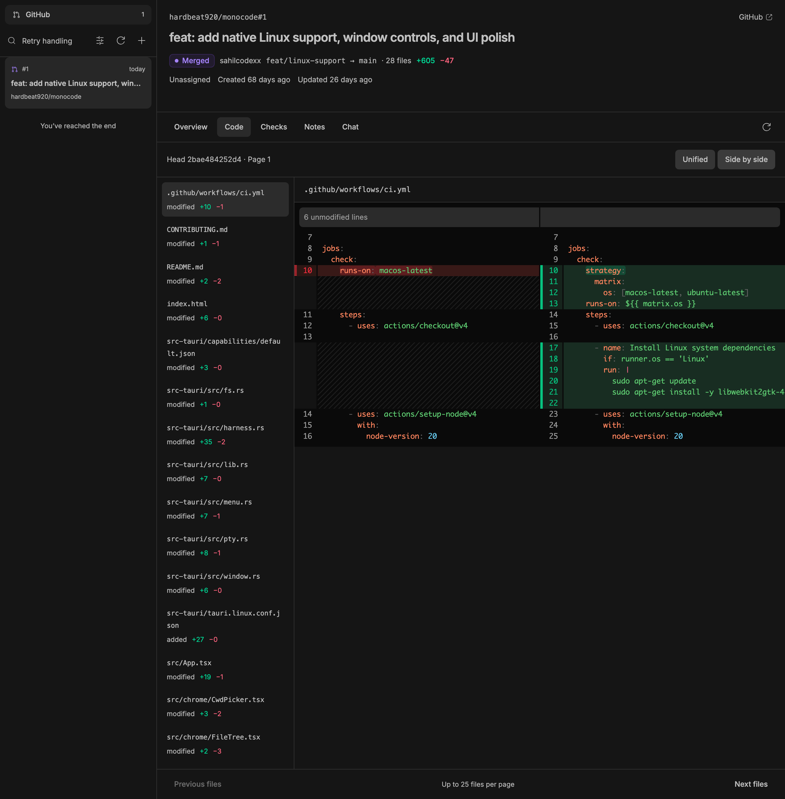
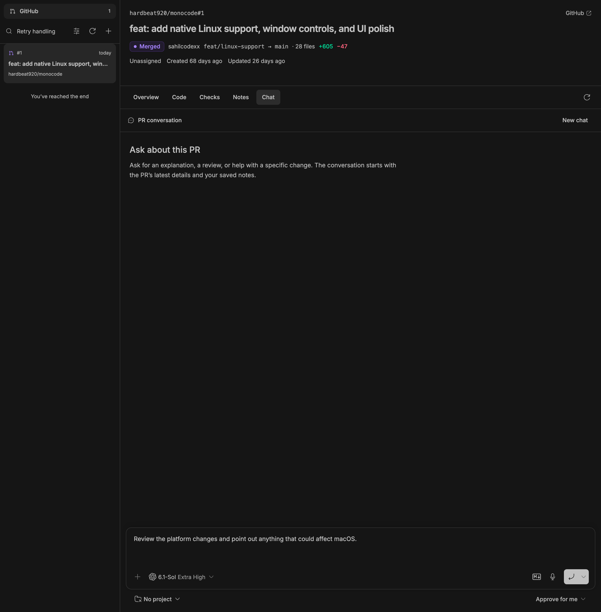

# PR Notes for BB

[](https://github.com/AdzeB/bb-plugin-pr-notes/actions/workflows/ci.yml)
[](https://github.com/AdzeB/bb-plugin-pr-notes/releases)
[](LICENSE)

Review pull requests, keep private notes, and chat with agents in BB.

PR Notes brings assigned PRs and review requests into one inbox. Read the description and activity, inspect diffs and checks, and open a conversation with the PR context already attached.

## Install

Requires BB 0.48 or newer with Plugin SDK 0.6.94 to 0.6.x, plus [GitHub CLI](https://cli.github.com) installed and signed in **on the BB server**.

```sh
gh auth login
bb plugin install 'git:https://github.com/AdzeB/bb-plugin-pr-notes.git@^0.1.0'
```

Open **PR Inbox** in BB. Use the filter menu to narrow by assignment, status, update date, or repository. The small **+** control opens any GitHub PR URL.

The plugin supports GitHub.com and the server's active `gh` account, including private repositories that account can access. GitHub Enterprise and account switching inside the plugin are not supported.

## What you can do

- **Overview:** read Markdown descriptions with code chips and file links, follow comments, commits, reviews, and state changes, and post a GitHub comment. Comment drafts stay available after a failed submission.
- **Code:** inspect paged file changes in unified or side-by-side view, with syntax highlighting and the inspected head SHA.
- **Checks:** see failed, cancelled, pending, passed, and skipped jobs, workflow names, durations, annotations, and run/log links.
- **Notes:** keep private Markdown notes for each PR, preview them, recover drafts, and resolve competing saves.
- **Chat:** use BB's native composer, providers, models, permissions, attachments, and environments. The input stays at the bottom, and existing PR conversations reopen.
- **PR actions:** merge, squash/rebase, mark draft/ready, or close/reopen according to your GitHub access. State changes ask for confirmation. Merges include GitHub's head-SHA guard and respect repository rules.

Opening a PR starts no agent. Starting a chat uses the provider you select and may incur its charges.

## Screenshots

These images show the running plugin with public and sample PR data. Personal projects, local paths, and unrelated BB threads are excluded.

### Overview



### Checks



### Code



### Chat



## Data and access

GitHub reads and writes use the GitHub CLI session on the BB server. The plugin stores no GitHub token of its own. Comments post to GitHub under that account; Notes remain in BB's plugin storage. Unsaved note and comment drafts use the browser tab's session storage.

When you start a conversation or request context, the PR content and saved notes are shared with the chosen agent provider. The selected local workspace is not silently switched to the PR branch. Verify the repository and revision before relying on local files.

Read caches last five minutes. Loaded pages and scroll position survive navigation within the running app. Refresh bypasses the caches, and PR actions invalidate relevant entries. Agent context and mutation preflight use fresh reads. Caches reset when the app or plugin reloads.

## Agent and CLI access

Linked conversations get the read-only `pr_notes_context` tool, with an optional bounded diff. The tool runs GitHub reads on the BB server, including when the thread runs on another machine.

```sh
bb pr-notes inbox --json
bb pr-notes inbox --cursor CURSOR --json
bb pr-notes context OWNER/REPO NUMBER --json
bb pr-notes note OWNER/REPO NUMBER --json
```

## Limits

The inbox loads 20 results per search stream at a time. GitHub search caps each stream at 1,000 results; narrow the filters for older PRs. Code loads 25 files per page, activity 30 events, checks 50 runs and 50 external statuses, and annotations 30 items. Shortened content links to GitHub.

Notes accept 60,000 characters and comments 60,000 UTF-8 bytes. Diff previews accept 200,000 characters per file and 1,000,000 per page. The conversation picker searches the latest 1,000 nonarchived plugin threads. GitHub reads time out after 30 seconds and have a 4 MiB output cap.

If a comment request is unconfirmed, refresh Activity before retrying. Confirmed request IDs are recorded to avoid duplicate retries. Comment bodies go to the CLI through stdin, not process arguments.

## Development and verification

Use Node 24 and run:

```sh
npm ci --ignore-scripts
npm run check
npm run build
```

For behavior checks, install the plugin in a development BB instance and run `npm run test:e2e`. The suite uses a separate headless browser profile and public/sample data. It intercepts comments, PR writes, and agent creation. Set `BB_SERVER_URL` for a different server, and `BB_PR_CHROMIUM` for an existing headless Chromium executable; otherwise install Chromium with `npx playwright install chromium`.

See [verification](docs/verification.md), [contribution guidance](CONTRIBUTING.md), and [security](SECURITY.md). Release tags are immutable, and the release workflow publishes a package and SHA-256 checksum after validation.

## Credits

Inspired by [Monocode](https://github.com/hardbeat920/monocode)'s notes and inbox discussion workflows. This is an original implementation using BB's public Plugin SDK. See [NOTICE](NOTICE) and the [MIT license](LICENSE).
